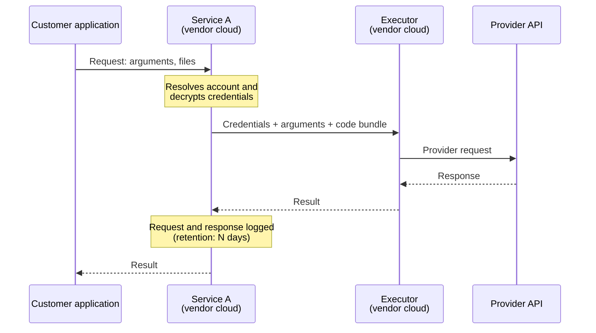
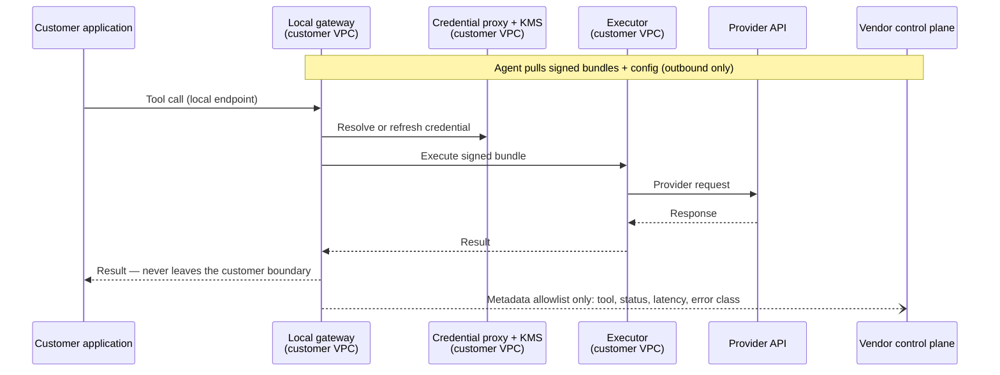
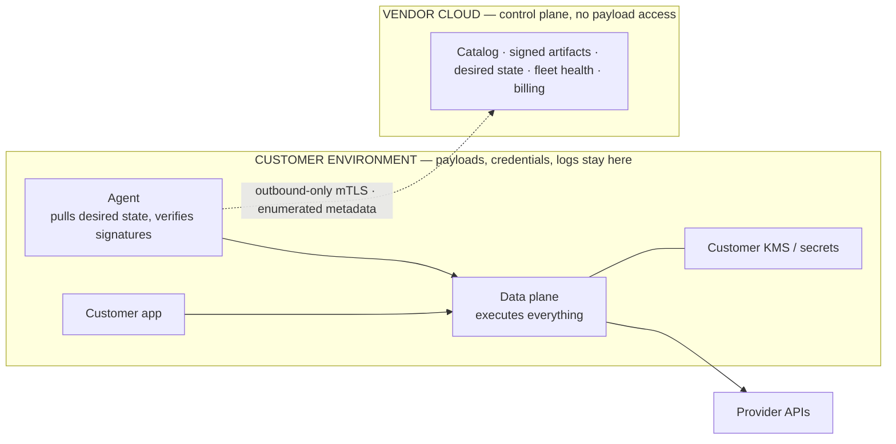
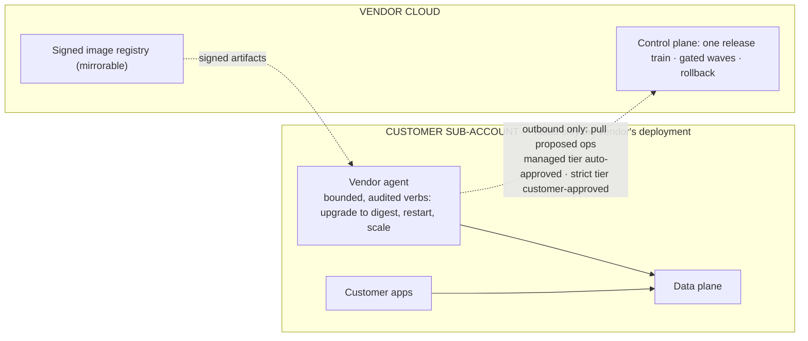

# Diagram snippets (Mermaid)

Render with `scripts/render_diagrams.sh <dir>`; every `.mmd` in the dir becomes a `.png`.

## Current request path (sequence)

## Option with a customer-hosted executor (sequence)

## Control plane / data plane split (flowchart)

## Vendor-operated deployment in a customer sub-account (flowchart)

Tips: `box … end` participant grouping needs Mermaid ≥ 10.3 — put the zone in the
participant label instead when the target renderer is older. Avoid parentheses inside
`box` titles. Check note text renders (set `noteTextColor`). Diagrams taller than wide
should be placed at reduced width.
